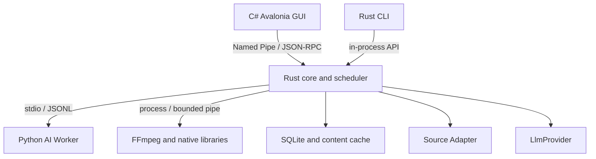

# 架构设计

状态：Phase 0 架构已验收，功能实现情况见 README。规范版本 0.1.0，日期 2026-11-17。

## 目标与边界

VideoSift 采用 Polyglot Architecture（多语言架构）与 Modular Monolith（模块化单体）。
Windows 11 x64 为首要目标，保留 Linux/macOS 后端替换能力。GUI 与 CLI 可独立使用；
不引入网络微服务、WebView、浏览器前端或容器依赖。

| 语言/组件 | 拥有的职责 | 禁止承担 |
| --- | --- | --- |
| Rust core | ProcessingTask 状态机、唯一调度、预算、缓存、SQLite、数据对齐、Provider、导出、子进程监管 | GUI 控件实现、未测量的底层重写 |
| C# desktop | MVVM、队列展示、时间轴、Markdown、资源读数、设置、本地化、主题 | 直接推理/解码/写业务数据库；阻塞 UI 线程 |
| Python AI Worker | VAD、ASR、OCR、模型适配、转换量化与基准实验 | 总调度、数据库写入、擅自下载或网络访问 |
| 原生库/FFmpeg | 解复用、解码、重采样、成熟张量运算 | 自行重写成熟算法；未经数据支持引入 FFI |

MVVM = Model-View-ViewModel；VAD = Voice Activity Detection；ASR = Automatic Speech Recognition；
OCR = Optical Character Recognition；FFI = Foreign Function Interface。

## 技术选型与引入时点

| 阶段 | 技术 | 工程目的 |
| --- | --- | --- |
| 1 | Rust stable/MSVC、Cargo workspace、Tokio、Serde/Schemars、rusqlite/FTS5、BLAKE3、Clap、Tracing | 调度、契约、持久化、内容寻址与独立 CLI |
| 2 | Reqwest、yt-dlp（受监管子进程） | 网络超时、限速、合法 Source Adapter 回退 |
| 3 | uv、Pydantic、sherpa-onnx、SenseVoiceSmall INT8、Silero VAD、RapidOCR、ONNX Runtime | 隔离推理、按需加载、CPU 基线 |
| 4 | FFmpeg CLI、QSV/D3D11VA 能力探测 | 媒体抽取、关键帧，先 CPU 后测量加速 |
| 5 | Codex CLI Provider + Mock Provider | 无额外付费 API 的可替换总结边界 |
| 6 | .NET 10 LTS、Avalonia、CommunityToolkit.Mvvm、Markdig | 原生 UI、绑定、Markdown AST 渲染 |
| 8 | Criterion、按需 Rayon/OpenVINO/CMake/原生扩展 | 证据驱动的优化与基准 |

faster-whisper 为 ASR 备选而非默认双重安装。ScottPlot 只在 Performance 图表需要时引入。
Rust 不提前拆成十个 crate：Phase 1 先建 core 与 cli，有真实边界后再拆。Markdig 解析
Markdown 为 AST（Abstract Syntax Tree，抽象语法树），用原生控件展示，禁用 HTML/WebView。
ONNX = Open Neural Network Exchange；FTS5 = Full-Text Search 5。

## 流水线与处理模式

1. 解析 URL/BV/分 P 或本地文件；规范化 Source ID，取得元数据与版本线索。
2. 检查缓存，优先请求合法可访问字幕；保留原始字幕证据。
3. 无字幕时只取音轨；VAD + ASR，输出带时间戳、语言与置信度的 Transcript。
4. Standard/Deep 按需取视频；关键帧结合场景变化、pHash、SSIM、局部区域与 OCR 差异。
5. 统一毫秒时间基、去重并保留原始证据；不把置信度未知当作 100%。
6. 限制上下文预算；Provider 输出结构化 Summary，Schema + 证据引用校验后持久化和导出。

| 模式 | 范围 | 数据及额度预算 |
| --- | --- | --- |
| Fast | 字幕优先；无字幕本地 ASR；文本摘要 | 不主动下载视频画面；限制文本上下文 |
| Standard | Fast + 关键帧/OCR、章节、术语、学习笔记 | 限制帧数、分辨率和 OCR 并发 |
| Deep | Standard + 按需视觉、公式/代码/拓扑/实验步骤、重点核验 | 用户显式选用；先本地筛选再请求视觉 |

pHash = Perceptual Hash；SSIM = Structural Similarity Index Measure。
不能只用全局场景变化，必须覆盖同页局部代码/公式变化。

## 调度、取消与恢复

状态集合见公共 Schema：queued、running、pause_requested、paused、waiting_provider、
cancel_requested、cancelled、succeeded、failed、interrupted。运行步骤写入 checkpoint，
只有输出原子提交后才完成该步骤。队列容量、并行度、CPU 线程/内存/磁盘预算由 Rust 管理。
I/O 用 Tokio；CPU 密集逻辑用有界 blocking pool，Rayon 只在基准证明有益时加入。

- pause 在步骤边界生效；无法立即中断的推理先进入 pause_requested，再 paused。
- cancel 请求幂等；先合作取消，超时终止整个进程树（Windows Job Object / Unix process group）。
- 成功提交与取消竞争按 Rust 状态事务顺序裁决；终态不会被迟到响应改写。
- Worker 崩溃使当前步骤失败/中断；仅幂等步骤可有限重试，不重复已提交结果。
- 重启将遗留 running/请求中状态标为 interrupted；核验缓存后由用户恢复。
- LLM 限额进入 waiting_provider，保存本地结果并暂停后续 LLM 派发；必须手动恢复。
- 默认候选并发：1 个 AI 推理任务，独立有界 I/O 队列。容量是待测配置，不是性能结论。

Worker 模型按需加载、同任务复用，空闲期限后释放；具体期限在 Phase 3 测量冷启动后决定。
子进程 stdin/stdout/stderr 同时有界读取，避免管道死锁。所有操作具有 deadline 和取消链路。

## Source Adapter

契约能力：resolve、metadata、available_subtitles、audio_stream、video_stream。
本地输入校验路径和媒体头；Bilibili 支持 BV/URL/分 P，拒绝缺失分 P 的歧义选择。
平台异常结构标为 Source 错误，不把空响应当作无字幕。先合法字幕，再合法音轨回退。
采用有限指数退避及 jitter，遵循 Retry-After；认证/权限/风控错误不无限重试或绕过。
不假设非公开 API 稳定，不嵌入 Cookie；真实网络测试和离线 fixture 分离。

## 持久化、检索与缓存

只有 Rust 写 SQLite；GUI/Worker 通过接口操作。候选 WAL（Write-Ahead Logging）模式，
迁移按事务编号执行；迁移前备份、磁盘不足回滚，版本过新时拒绝写入。
设计实体：video、processing_task、checkpoint、artifact、transcript_segment、knowledge_item、summary。
Phase 1 再写实际 DDL，不生成空数据库。

缓存按阶段独立：metadata、subtitle、ASR、OCR、keyframe、knowledge、summary。
键为 BLAKE3(canonical JSON)：source_id、content_version、content_fingerprint、part_id、
stage、model/version、inference_params、algorithm_version、prompt_version、schema_version。
canonical JSON 固定 UTF-8、键排序、无多余空白、拒绝非有限数；具体实现需金样本测试。
URL 本身不作为内容版本。依赖阶段变化只使下游失效。

缓存写临时文件、校验长度/哈希后原子 rename，最后事务发布索引；读取再次核验内容。
崩溃后回收未被引用的临时输出。按磁盘预算和最近使用清理，活跃任务引用不得淘汰。
数据库索引与文件不同步时进入可恢复 Storage 错误，不静默返回坏结果。

中文检索不能假设 unicode61 自动分词。Phase 1 用合成中文语料比较预分词、bigram 和
FTS5 trigram（短于三个字符另行处理）；记录短词、混合英文/代码、标点的命中率和索引成本，
达标后选择 tokenizer。用户查询参数化并转义 MATCH 表达式，禁拼 SQL。

## LLM 边界与输出

Provider 输入是限长、带 evidence_id 的不可信文本；输出区分 video、model_inference、
external_knowledge。重要断言应关联原始证据；无证据时标明推断和不确定性，不伪造引文。
Schema 草案只覆盖最小共同域，完整学习笔记字段（公式、代码、命令、步骤、复习题、术语全称）
将在 Phase 5 增量版本化；不得用未校验的自由字典绕过契约。

Provider 接入前须检查实际安装版本的参数能力。模型 ID 与推理强度均不得预设可用；
开发只用 Mock。JSON Schema 输出后仍作语义/证据校验。记录使用量缺失为 unknown，而非零。
只读 sandbox 不能单独证明隔离了凭据和工具；Phase 5 必须通过 [安全门禁](SECURITY.md)。

## 参考依据

核验于 2026-11-17：[.NET 支持周期](https://dotnet.microsoft.com/en-us/platform/support/policy)、
[Avalonia .NET 10 支持](https://docs.avaloniaui.net/docs/avalonia12-breaking-changes)、
[sherpa-onnx SenseVoice](https://k2-fsa.github.io/sherpa/onnx/sense-voice/index.html)、
[SQLite FTS5 tokenizer](https://www.sqlite.org/fts5.html#tokenizers)。依赖精确版本在首次引入时重验。
